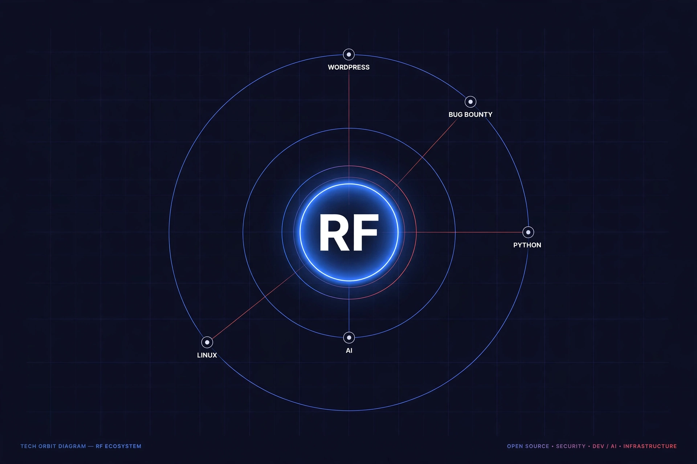

<!-- Editorial restyle — dark navy / blue / red. Replaces the ASCII-art profile. -->

<p align="center">
  
</p>

<table>
  <tr>
    <td width="170" valign="top">
      
    </td>
    <td valign="top">
      <h3>FAIZAN BALOCH</h3>
      <p><strong>WordPress Security Researcher &amp; Bug Bounty Hunter</strong></p>
      <p>I hunt vulnerabilities in WordPress plugins and themes — business logic, IDOR, auth bypass, payment &amp; checkout flaws — and report them responsibly, with proof.</p>
      <p>
        🌐 <a href="https://realf4izan.github.io/portfolio/">realf4izan.github.io/portfolio</a> &nbsp;·&nbsp;
        ✉️ <a href="mailto:realf4izan@gmail.com">realf4izan@gmail.com</a> &nbsp;·&nbsp;
        📸 <a href="https://www.instagram.com/real_f4izan/">@real_f4izan</a>
      </p>
    </td>
  </tr>
</table>

---

<table>
  <tr>
    <td valign="top" width="50%">

### 01 / FROM THOUGHT TO THING

```
$ hunt()
  scope → read → test → report
```

**THINK** — Read the code. Map the logic. Find where trust is assumed.

**EXECUTE** — Test it in the lab. Reproduce it, cleanly.

**BUILD** — Report it responsibly, with proof.

- Business-logic flaws
- IDOR &amp; broken access control
- Auth bypass
- Payment &amp; checkout flaws

    </td>
    <td valign="top" width="50%">

### 02 / LIFE OUTSIDE THE COMMIT


1. **Teaching cyber security** — beginner lectures in Roman Urdu, from absolute zero.
2. **AI video editing** — CapCut + AI tools, mobile-first.
3. **Building websites &amp; tools** — security tools and portfolio sites.

> **MENTORSHIP** — Teaching beginners that you don't need a laptop to start learning security. A phone and curiosity are enough.

    </td>
  </tr>
</table>

---

<p align="center">
  
</p>

---

## 03 / MY ONLINE ROOM

<p align="center">
  
</p>

**Languages**


**Frontend &amp; Runtime**


**Backend, Cloud &amp; AI**


---

## THINGS I'VE BUILT

| Project | What it does | Focus |
|---|---|---|
| [realf4izan.github.io/portfolio](https://realf4izan.github.io/portfolio/) | Personal site — research hub and portfolio | WordPress security |
| **oneshot_recon.py** | OSINT dossier builder — scoped recon reports | Python · OSINT |
| [realf4izan / realf4izan](https://github.com/realf4izan/realf4izan) | This profile — dark editorial README | GitHub profile |

---

## OPEN SOURCE

| Project | What it does | Focus |
|---|---|---|
| [wp-ajax-audit](https://github.com/realf4izan/wp-ajax-audit) | WordPress AJAX/REST authorization auditor — finds handlers missing auth checks | Python · WordPress security |
| [bug-bounty-playbook](https://github.com/realf4izan/bug-bounty-playbook) | Business-logic hunting playbook + report templates | Bug bounty · WordPress |
| [wp-cve-hunter](https://github.com/realf4izan/wp-cve-hunter) | WordPress plugin/theme CVE fingerprinter — fork of [gravion-ux/wp-cve-hunter](https://github.com/gravion-ux/wp-cve-hunter) | Python · CVE research |

**Collaborator:** [gravion-ux](https://github.com/gravion-ux) (Priyanshu Kumar Thakur) — collaborator on wp-cve-hunter.

---

## REAL WORK. REAL IMPACT.

<p align="center">
  
</p>

| 02 | 01 | 02 |
|---|---|---|
| **VALIDATED REPORTS** — Patchstack | **CVE** — CVE-2026-131592 | **PLATFORMS** — Patchstack + Wordfence |

- **CVE-2026-131592** — validated stored XSS in AgeChecker (Wordfence bounty proposed).
- **3 validated Patchstack reports** — uListing (broken access control), MailUp (CSRF → stored XSS) + One Click Order Reorder (stored XSS).

**CORE CRAFT**

```
WordPress plugin audit      ████████████████████
Business-logic flaws        ████████████████████
Payment & checkout flaws    ████████████████████
Responsible reporting       ████████████████████
```

*Bars mark focus areas, not scores.*

---

## SUPPORT MY WORK

If my open-source security work helps you, consider [sponsoring me on GitHub](https://github.com/sponsors/realf4izan) — it keeps the hunting and the tooling going.

---

## LET'S CONNECT.

### BUILD SOMETHING GREAT.

|  |  |
|---|---|
| 🌐 Website | [realf4izan.github.io/portfolio](https://realf4izan.github.io/portfolio/) |
| ✉️ Email | [realf4izan@gmail.com](mailto:realf4izan@gmail.com) |
| 📸 Instagram | [@real_f4izan](https://www.instagram.com/real_f4izan/) |
| 💻 GitHub | [@realf4izan](https://github.com/realf4izan) |

---

*Hunting bugs, one WordPress plugin at a time.*
